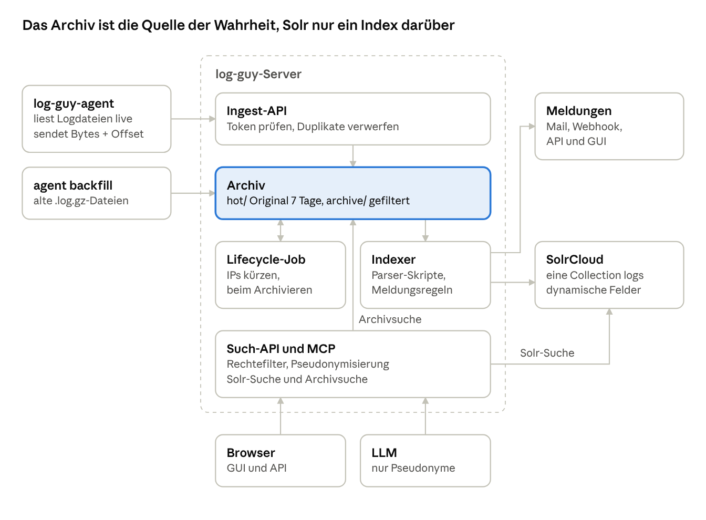

# Architekturüberblick

Logs fließen vom Agenten über die Ingest-API unverändert ins Archiv. Indexer und Lifecycle-Job arbeiten nur auf dem Archiv. Der Indexer zerlegt die Zeilen mit den Parser-Skripten in Felder und prüft dabei die Meldungsregeln. Browser und LLM erreichen Solr und Archiv ausschließlich über die Such-API, die Rechte und Pseudonymisierung durchsetzt.

[Zur Übersicht](README.md)
